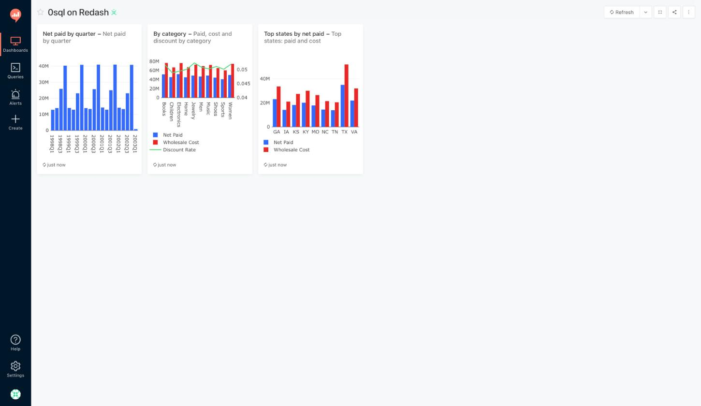
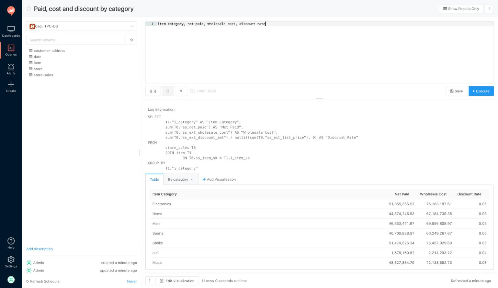
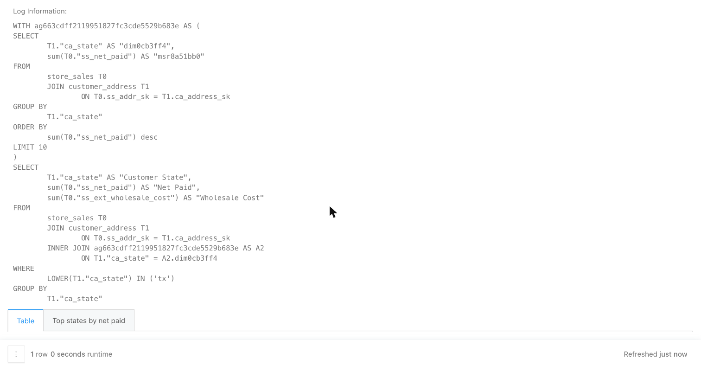

# Redash + 0sql

Redash, unchanged, with one query runner added: you type a line in business
terms, [0sql](https://github.com/stratasite/0sql) plans the SQL against a
semantic model, Redash runs it and draws the chart.

```
contact channel, aht mins, escalation rate, month(contact date)
```



Nothing is compiled and neither project is vendored here. Both arrive
prebuilt, at the versions the demo runs:

| | |
|---|---|
| [getredash/redash](https://github.com/getredash/redash) | the official `redash/redash:26.9.0` image, unchanged |
| [stratasite/0sql](https://github.com/stratasite/0sql) | the published `zsql` release binary, v0.6.0 by default |
| [stratasite/customer-service](https://github.com/stratasite/customer-service) | the semantic model and its Parquet data, as the one submodule |

Everything in this repository is the glue:

| | |
|---|---|
| [`redash_zsql.py`](redash_zsql.py) | the query runner, one file, enabled with `REDASH_ADDITIONAL_QUERY_RUNNERS` |
| [`customer-service/`](https://github.com/stratasite/customer-service) | submodule: the model the demo queries, 26 tables, 532 fields, 1 policy |
| [`compose.yaml`](compose.yaml), [`docker/`](docker) | Redash, zsql, Redis and Postgres as one stack |
| [`test_redash_zsql.py`](test_redash_zsql.py) | the runner's checks, which need no Redash installed |
| [`demo.sh`](demo.sh) | from nothing to a dashboard, one command |

## Run it

Needs Docker with Compose v2, python3 and openssl. Both images are pulled,
not built, so the first run is a download and a warehouse build rather than
a compile.

```sh
git clone --recurse-submodules https://github.com/stratasite/redash-0sql
cd redash-0sql
./demo.sh
```

The submodule carries the model and the Parquet it is built from, about
6 MB. If you already cloned without it, `git submodule update --init`.

`ZSQL_VERSION` in `.env` picks the zsql
[release](https://github.com/stratasite/0sql/releases) to pull; the image is
tagged with it, so changing it swaps versions on the next `docker compose up`.

Then open http://localhost:5055 and sign in:

| who | sign-in | sees |
|---|---|---|
| admin | `admin@example.com` / `admin` | everything |
| Dana | `dana@example.com` / `demo` | cost measures for AMER only, same queries |

The script builds the warehouse in DuckDB from the submodule's Parquet, one
table per file, seeds a dashboard with three saved queries, and prints the
links. `docker compose down -v` resets.

## What you get in Redash

**A new data source type, "0sql".** Point it at a 0sql server and a project.
The schema sidebar lists the model's dimensions and measures per table, and
autocompletes them, instead of raw warehouse columns.

**Queries in business terms.** Anything the 0sql shorthand takes:

```
month(contact date), contacts
call center region, cost per contact usd, contacts
contact channel, aht mins, escalation rate, sla rate
agent tenure weeks, aht mins, contact channel top 5 by contacts
```

Measures like `escalation rate` or `cost per contact usd` are defined once, in the model.
Joins are found, not written. A name that does not resolve comes back as an
error naming the nearest fields. A 0sql spec as a JSON object is accepted in
place of a line, which is what an agent would send.

**The SQL, every time.** The planned statement shows on the query page under
the results, so nothing is hidden. Prefix a line with `explain` to get only
the SQL, as rows.



**Row-level security, which Redash does not have.** The model carries one
policy: measures tagged `cost-sensitive` (cost per contact, telecom cost,
total contact cost) are filtered to the call center regions on the caller's
groups. The runner sends the Redash user as the 0sql security context, and a
Redash group named `region:AMER` reaches the policy as that tag. Dana, in
that group, runs the same saved query as the admin and gets AMER. A user with
no region tag gets `WHERE 1 = 0`, because the policy denies the unresolved
case. Redash admins plan as system admins and bypass it.



```yaml
# customer-service/security.yml
policies:
  - name: Regional Cost Visibility
    mode: filter_data
    triggers: { field_tags: [cost-sensitive] }
    context_dimension: Call Center Region
    permission_resolution: { source: groups, value_from: tag, tag_key: region, unresolved: deny }
    bypass: { system_admin: true, project_admin: true }
```

## How the runner works

0sql never connects to a warehouse: it is given the shape of the tables and
returns SQL. The runner does the rest, in Redash's own terms.

| Redash hook | what the runner does |
|---|---|
| `run_query(query, user)` | POST the line (or spec) and the user's context to `/sql`, hand the SQL to the warehouse data source, return rows with the SQL as the result log |
| `get_schema()` | GET `/fields`, grouped by table, each tagged measure or dimension |
| `test_connection()` | GET `/tables`, and check the named data source exists and speaks SQL |
| `should_annotate_query = False` | Redash would otherwise prefix a `/* user_id */` comment the shorthand rejects |

The security context from a Redash user:

```python
{"email": user.email,
 "system_admin": "admin" in user.permissions,
 "groups": [{"name": g.name, "tags": [g.name] if ":" in g.name else []} for g in groups]}
```

The warehouse is **whatever Redash already connects to**. The runner opens no
database of its own and knows no dialect; it names an existing Redash data
source and hands it the statement. That is how it meets an existing Redash:
keep the Postgres, Snowflake or BigQuery connection you have, add a 0sql data
source that runs through it, and write the model for those tables. The demo
does exactly this, with a plain Redash DuckDB data source as the warehouse.

## Use it with your own warehouse

1. Write a model for your tables: copy the
   [customer-service](https://github.com/stratasite/customer-service) layout
   and edit. The
   [semantic model docs](https://0sql.io/docs/semantic-model/) cover
   dimensions, measures, joins and policies; `datasources.yml` names your
   dialect (13 are supported).
2. Serve it: `zsql serve` inside the model directory, or point the compose
   file's `model` volume at it.
3. In Redash, add a 0sql data source with the project uid and the name of the
   Redash data source that holds your warehouse connection.

## Known limits

- Redash caches results per query text, shared by everyone who can see the
  query. A saved query's cached result was planned for whoever ran it last;
  a regional user opening it sees that result until they refresh. Per-user
  cache keys need a change in Redash, not in the runner.
- The editor highlights the line as plain text. Field names autocomplete
  from the schema; decorators and predicates do not.
- The Redash CLI's `users create --groups` wants a trailing comma in this
  version; `demo.sh` works around it.

## Layout

```
customer-service/  submodule: the model and its Parquet; mounted at /model for zsql
redash_zsql.py     the query runner
test_redash_zsql.py  its checks; needs no Redash, `python3 test_redash_zsql.py`
seed_warehouse.py  the submodule's Parquet into DuckDB, run inside the Redash image
docker/            redash.Dockerfile (official image + runner), zsql.Dockerfile (release binary)
compose.yaml       the stack; .env is written by demo.sh
demo.sh            start, seed, dashboard
```

MIT, like both projects it joins.
